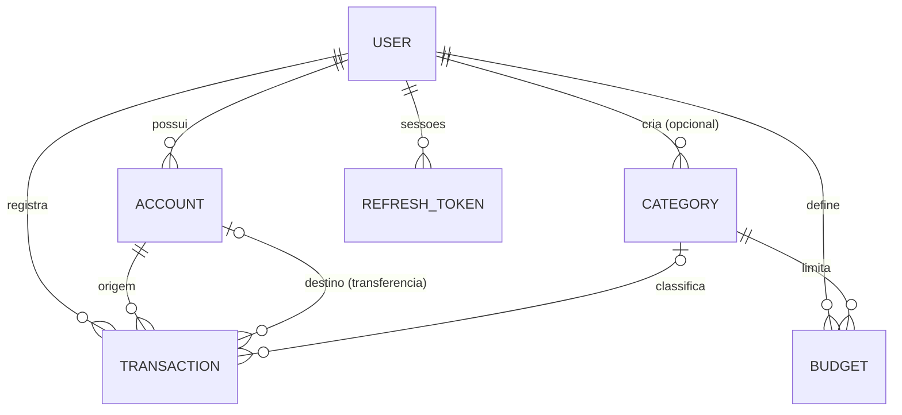

# Modelo de dados

Decisões:
- **Centavos inteiros** (`amountCents`, `initialBalanceCents`, `limitCents`): evita erro de ponto flutuante.
- **Saldo derivado**: `inicial + receitas - despesas - transferências enviadas + recebidas`.
- **Categorias padrão** têm `userId = null` e `isSystem = true`; são sincronizadas na inicialização da API.
- **Soft delete** (`active`) em contas e categorias com histórico.
- **`Transaction.date` é `DATE`**: sem fuso, então o corte de mês nunca "escorrega" de dia.
- **Transferência**: `type = TRANSFER`, `destinationAccountId` preenchido, sem categoria, fora de receitas/despesas do painel.
- **Índices**: `(userId, date)` em transações, `userId` nas demais tabelas.
